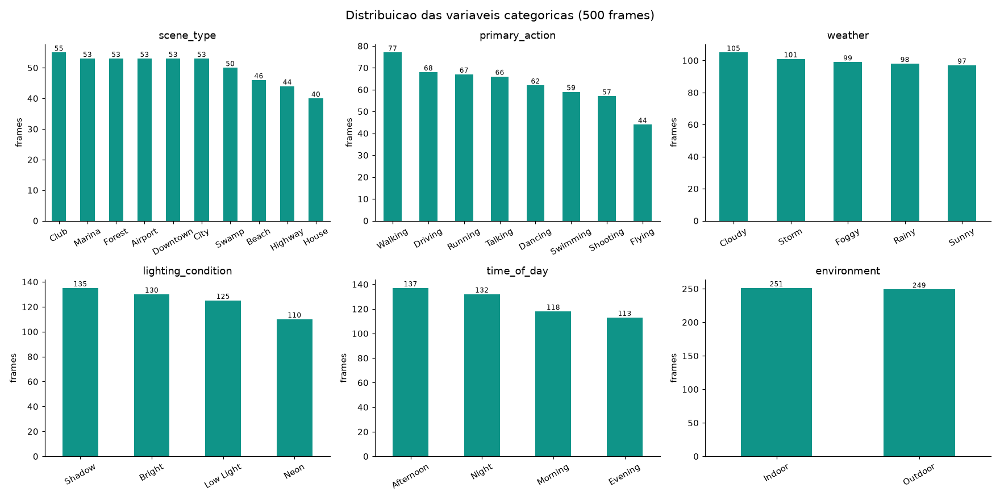
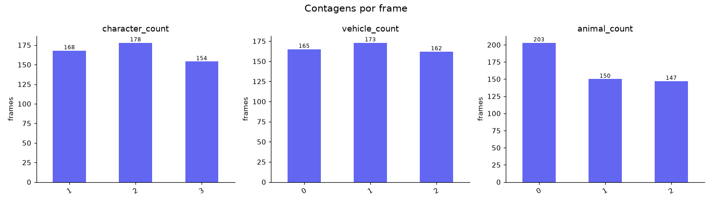
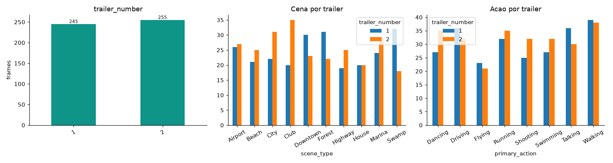
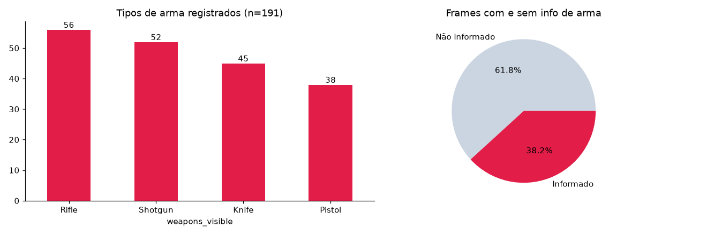
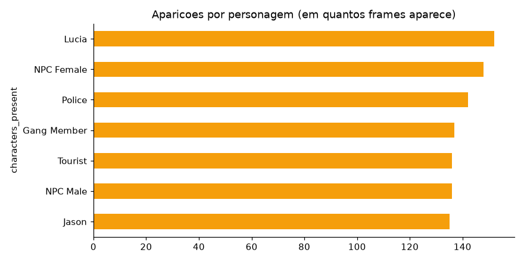
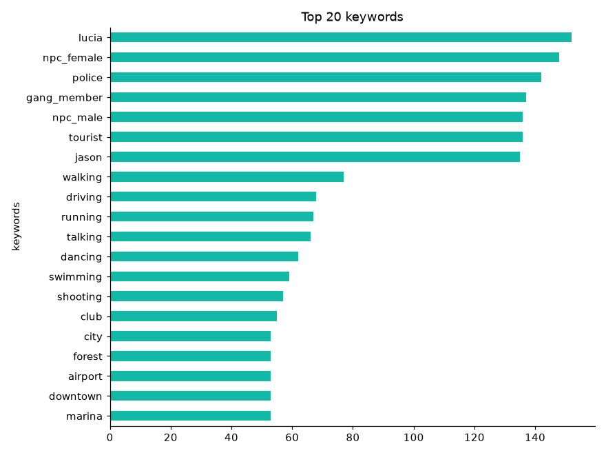
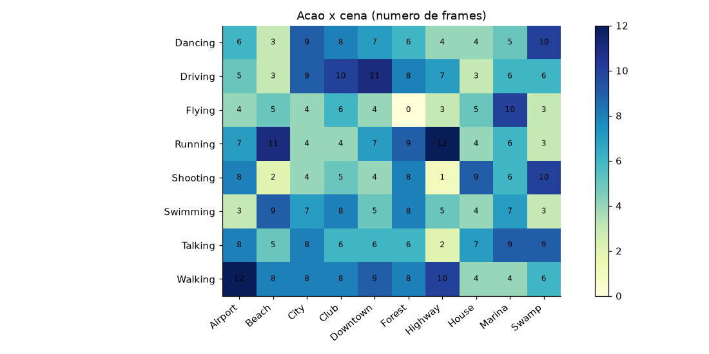
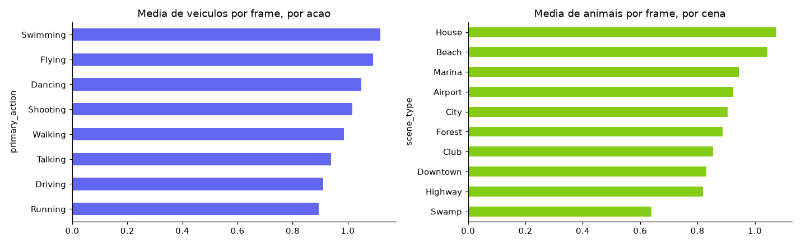

# Análise Exploratória de Dados: GTA VI

EDA em **Python (pandas, SQLite, SciPy, Matplotlib)** sobre um dataset de frames anotados dos trailers de GTA VI.

> **Principal achado:** o dataset tinha **95% de linhas duplicadas** (cada frame aparecia 20 vezes). Ao corrigir isso, o resultado de um teste estatístico passou de *significativo* (p < 0,0001) para *não significativo* (p = 0,73).

---

## Sobre o projeto

| Item | Valor |
|---|---|
| Banco de dados | `gta.db` (SQLite) |
| Tabela original | `gta6_dataset`: 10.000 linhas × 22 colunas |
| Tabela final | `gta6_final`: 500 linhas × 24 colunas |
| Unidade de análise | 1 linha = 1 frame de trailer |

**Colunas principais:** `scene_type`, `primary_action`, `weather`, `lighting_condition`, `time_of_day`, `environment`, `characters_present`, `character_count`, `vehicles_present`, `vehicle_count`, `animals_present`, `animal_count`, `weapons_visible`, `image_caption`, `keywords`.

## Etapas

1. **Exploração inicial:** dimensões, valores ausentes e distribuição dos trailers.
2. **Tratamento de valores ausentes:** `animals_present`, `vehicles_present` e `weapons_visible`.
3. **Detecção de duplicados:** 9.500 linhas repetidas, resultando em 500 frames únicos.
4. **Validação estatística** refeita sobre os dados únicos.
5. **Checagem de consistência** entre colunas.
6. **Visualização** das distribuições.

---

## Limpeza dos dados

### Duplicados
- `frame_id`, `image_filename` e a linha inteira tinham **9.500 duplicados**.
- Cada frame aparecia exatamente **20 vezes**.
- Depois de `drop_duplicates()`: **500 frames únicos**, com `frame_id` único.

### Valores ausentes (500 frames únicos)

| Coluna | Ausentes | Tratamento |
|---|---|---|
| `weapons_visible` | 309 (61,8%) | `"Não informado"` + coluna `weapons_info_status` |
| `animals_present` | 203 (40,6%) | `"Nenhum"` (todo NULL tem `animal_count = 0`) |
| `vehicles_present` | 165 (33,0%) | `"Nenhum"` (todo NULL tem `vehicle_count = 0`) |

Em `weapons_visible`, o NULL **não** foi tratado como "sem arma". Dos 57 frames com `primary_action = "Shooting"`, 35 (61,4%) não têm arma registrada, o que seria contraditório. O NULL significa "não registrado".

### Inconsistências sinalizadas (os registros foram mantidos)

| Inconsistência | Frames | Onde está |
|---|---|---|
| Tiro sem arma registrada | 35 de 57 | coluna `tiro_sem_arma_registrada` (tabela `gta6_final`) |
| Direção sem veículo | 24 de 68 | coluna `dirigindo_sem_veiculo` (criada em `EDA.py`, não gravada no banco) |

### Verificações que passaram
- `character_count` bate com o número de nomes em `characters_present` nos 500 frames.
- As categorias não têm erros de digitação.
- Todo NULL de animais e veículos corresponde a contagem zero.

---

## Impacto da duplicação na estatística

Qui-quadrado de independência entre `scene_type` e ausência de informação de armas:

| | Com duplicados (10.000) | Dados únicos (500) |
|---|---|---|
| χ² | 121,55 | 6,08 |
| p-valor | < 0,0001 | **0,7322** |

Com os duplicados, o teste tratava 10.000 observações como independentes e "encontrava" uma relação que não existe. O V de Cramér (0,110) não muda com a replicação e, sozinho, enganaria.

## Testes estatísticos (500 frames)

| Teste | p-valor | Conclusão |
|---|---|---|
| Ausência de arma × cena | 0,732 | Sem associação |
| Armas × distribuição uniforme | 0,267 | Sem diferença entre as armas |
| Ambiente × cena | 0,543 | Sem associação |
| Horário × iluminação | 0,485 | Sem associação |

---

## Gráficos

### Variáveis categóricas


Cena, ação, clima, iluminação, horário e ambiente são bem equilibrados. Nenhuma categoria domina.

### Contagens por frame


Personagens (1 a 3), veículos (0 a 2) e animais (0 a 2) por frame.

### Trailers


O Trailer 2 tem 255 frames e o Trailer 1 tem 245.

### Armas


Entre os 191 frames com informação: Rifle 56, Shotgun 52, Knife 45 e Pistol 38. Os 309 restantes (61,8%) não têm arma registrada.

### Personagens


Todos os personagens aparecem em 135 a 152 frames.

### Palavras-chave


As keywords repetem personagens, ação e cena, sem informação nova.

### Ação × cena


### Médias por frame


> **Atenção:** os gráficos 03, 07 e 08 mostram diferenças entre grupos (por exemplo, Club com 20 frames no Trailer 1 e 35 no Trailer 2). Com apenas 500 frames e variáveis independentes, essas diferenças provavelmente são ruído e **não foram testadas**. Não devem ser lidas como achados.

---

## Conclusões

1. **A qualidade dos dados foi o achado central.** Sem remover os duplicados, as conclusões estatísticas seriam falsas.
2. **As variáveis são quase uniformes e independentes entre si.** Há frames noturnos com iluminação "Bright" e cenas de praia marcadas como "Indoor".
3. **`keywords` e `image_caption` não trazem informação nova:** derivam de cena, ação e personagens.
4. **NULL em `weapons_visible` significa "não registrado"**, e não "sem arma".

## Limitações

- Só 500 frames únicos, então diferenças pequenas (como Rifle 56 contra Pistol 38) não são estatisticamente distinguíveis.
- A independência entre as colunas sugere que o dataset foi gerado de forma sintética. Essa é uma **hipótese**, não uma certeza.
- Por isso, afirmações como "a rodovia tem mais cenas de X" não são sustentadas pelos dados.
- Não foram testadas as relações entre ação × cena, clima × horário e trailer × cena.

---

## Como reproduzir

```bash
pip install pandas numpy scipy matplotlib seaborn
```

1. Clone o repositório e mantenha o `gta.db` na raiz.
2. Abra o `EDA.ipynb` (processo completo, da exploração à limpeza) ou rode o `EDA.py` (somente os gráficos, a partir da tabela `gta6_final`). No VS Code, cada `# %%` do `EDA.py` é uma célula.
3. Os gráficos são salvos na pasta `graficos/`.

## Estrutura do repositório

```
EDA/
├── gta.db            # banco SQLite
├── EDA.ipynb         # exploração, limpeza e validação
├── EDA.py            # gráficos e resumo final
├── graficos/         # imagens geradas (01 a 08)
└── README.md
```

**Tabelas no `gta.db`:**

| Tabela | Linhas | Colunas | Conteúdo |
|---|---|---|---|
| `gta6_dataset` | 10.000 | 22 | Dados originais |
| `gta6_tratado` | 10.000 | 24 | Valores ausentes tratados, ainda com duplicados |
| `gta6_unico` | 500 | 22 | Originais sem duplicados |
| `gta6_final` | 500 | 24 | Sem duplicados, tratada e com flags de armas |

> Use a `gta6_final` para as análises. A `gta6_tratado` serve só para documentar o antes e o depois da remoção de duplicados.
